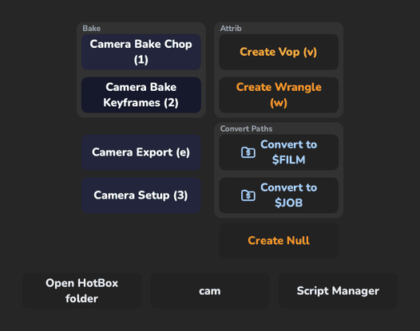
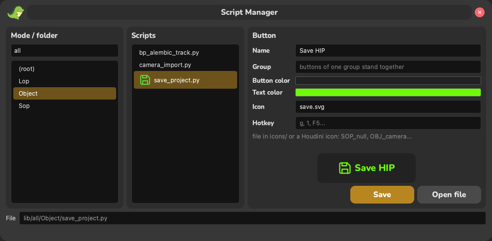

# HotBox

A popup under the mouse with buttons for your own Python scripts in Houdini 21+.
Inspired by [W_hotbox](https://github.com/melMass/W_hotbox) for Nuke (the idea of the hotbox and the Script Manager),
written from scratch for Houdini.
HotBox is an orchestrator: it doesn't do anything by itself, it finds the scripts in `lib/`, shows the ones that fit
what you are doing and runs them.

<p align="center">
  
  
</p>

## What it shows

| Selection | Folder | Columns |
|---|---|---|
| nothing | `lib/all/` | scripts of the current network type (`Sop/`, `Lop/`, `Object/`, `Driver/`…) + root scripts |
| several nodes | `lib/multiple/` | scripts of the network type + root scripts |
| one node | `lib/single/` | scripts of the node type (`cam/`, `null/`…) + root scripts |

Deeper folders (`lib/all/Lop/Instances/`) are not shown.

Buttons go top to bottom in columns (context scripts, then root scripts), at most 6 per column, and all
columns share one grid, so rows are on the same level. Single buttons and `#group` blocks are sorted by group name /
label (not by file names). A group is a framed block with a caption; it is never split between columns; a group with
one button is a plain button.

Bottom row: open the HotBox folder · current context (click to close) · Script Manager.
`Esc` or `` ` `` closes the hotbox, so does a click anywhere that is not a button (outside or between buttons). Clicking a button or pressing its hotkey closes the hotbox and runs the script.
Hotkeys work in the Russian keyboard layout too (the same physical key: `f` = `а`).
Everything a script does is one undo step.

Animations: on hover a white wave spreads from the cursor, the button gets lighter and a bit bigger (with the text).
On click or hotkey the button grows and fades out while the whole menu fades out, then the script runs.

## Adding a script

Drop a `.py` file into the right folder. Its button is described by the first comment lines:

```python
#label:Create Null
#textcolor:#ff8b48
#buttoncolor:#22253b
#icon:app_dino_dance.svg
#hotkey:n
#group:Nodes

import hou
...
```

Write scripts for any number of selected nodes (`for node in hou.selectedNodes()`): then one script serves
`lib/single/` and `lib/multiple/`.

### The same tool in another mode: `#ref`

A file with only a header runs another script from `lib/`:

```python
#ref:single/create_null.py
#hotkey:n
```

It takes the label, colors, icon and group of the target (its own header overrides them); the hotkey is not
inherited, choose it per context. A broken reference (file renamed, loop) shows a red button with the reason
in the tooltip; the tests check every `#ref` in `lib/`.



Or edit them in the **Script Manager** (bottom right button, the DinoWrite look, with a live animated preview of
the button): it writes the header back into the script and warns
about hotkeys already used by scripts shown together with it and about missing icons. For a `#ref` it edits only
the reference's own header (inherited values are shown greyed out).

All keys are optional (the label defaults to the file name). `#icon` is a file in `icons/` (`save.svg`) or a
Houdini icon name, the one `node.type().icon()` returns (`SOP_attribwrangle`, `SOP_null`, `OBJ_camera`, `LOP_fetch`...).
The script runs as `__main__`, `sys.exit()` just stops it, errors are printed to the console and shown in the status bar.

### Shared helpers: `common/`

Small pieces several scripts need, split by topic (whole tools stay scripts in `lib/`):

| Module | |
|---|---|
| `common/panes.py` | Network Editor / Scene Viewer under the cursor, status bar warnings |
| `common/nodes.py` | node paths from the clipboard, Object Merge / Fetch at the cursor, attrib VOP/wrangle under the selection |
| `common/paths.py` | file parameters of a node, `$JOB`/`$FILM` path conversion |

```python
from hotbox.common import paths

paths.convertPaths("$JOB")
```

Headers are read from the files every time the hotbox opens: nothing is cached, nothing is written into the tool folder.
The folder can be copied from user to user as is.

> Older versions kept a `lib/<mode>/schema.json` cache with absolute paths of the machine it was created on, and it
> had to be deleted after copying the tool to another user. It isn't used any more: delete leftover `schema.json`
> files, they are ignored by git.

## Install

Put the `hotbox` folder into `python3.11libs` of your Houdini preferences or package
(e.g. `~/houdini21.0/python3.11libs/hotbox`). Hotkey or shelf tool:

```python
import hotbox
hotbox.show()
```

Updated code is reloaded automatically on the next `show()` (no Houdini restart). The old
`from hotbox import main; main.start()` still works.

Camera Import / Camera Export use the studio `cam_tools` library: set its folder in `houdini.env`:

```
CAM_TOOLS_PATH = "//<server>/tools/py_libs/camera_exchanger"
```

The Flipbook button runs [DinoWrite](https://github.com/matzubr/DinoWrite), installed next to `hotbox`.

## Development

Houdini imports the folder directly; [uv](https://docs.astral.sh/uv/) is only for dev tooling (Python 3.11 like Houdini 21,
PySide6 for offscreen GUI tests, `hou` is stubbed). The repo folder must be named `hotbox`.

```bash
uv sync
uv run pytest
uv run ruff check __init__.py main.py common utils tests
uv run --with pillow python docs/make_images.py   # README images
```

## Credits

Buttons use [Nunito](https://github.com/googlefonts/nunito) ExtraBold (`fonts/`, a static cut of the variable font),
SIL Open Font License 1.1, see `fonts/OFL.txt`.
