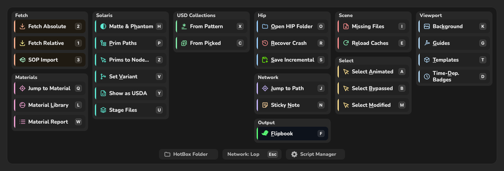

# HotBox

**Your scripts, one keystroke away.** A popup that blooms under the cursor in Houdini 21+ and shows only the
buttons that fit what you're doing: one camera, a pile of SOPs, an empty Solaris network.

HotBox does nothing by itself. It finds the scripts in `lib/`, picks the ones for the moment and runs them.
The idea comes from [W_hotbox](https://github.com/melMass/W_hotbox) for Nuke; the code is written from scratch for Houdini.

<p align="center">
  
  
</p>

## In the hand

- **Context.** The folder that matches the selection and network decides which buttons show:

  | Selection | Folder | Buttons |
  |---|---|---|
  | nothing | `lib/all/` | the network type (`Sop/`, `Lop/`, `Object/`…) + root scripts |
  | several nodes | `lib/multiple/` | the network type + root scripts |
  | one node | `lib/single/` | the node type (`cam/`, `null/`…) + root scripts |

- **Hotkeys.** Each button has one in a keycap. They also work in the Russian layout (`f` = `а`). `Esc` closes.
- **Search.** `Tab` and a few letters: the rest fades away, `Enter` runs the first match.
- **Groups.** `#group` frames buttons under a caption. A group always keeps its place, so muscle memory holds.
- **One undo.** Everything a script does undoes in one step. If it fails, you get the traceback and a jump to the
  failing line.

<p align="center"></p>

## Writing a button

Drop a `.py` file into the right folder. A few comment lines describe its button, and every one is optional:

```python
#label:Create Null
#group:Create
#hotkey:q
#icon:null.svg             # a file in icons/ or any Houdini icon: SOP_null, LOP_fetch…
#textcolor:#ff8b48         # stripe and line icon
#package:studio-name       # shown only when the package is on

import hou
for node in hou.selectedNodes():
    ...
```

To reuse a tool in another context, write a header-only file. It inherits everything except the hotkey:

```python
#ref:single/create_null.py
#hotkey:n
```

Or skip the typing and use the **Script Manager**: fields for every key, a hotkey recorder that names clashes, an
icon browser, a live preview, and a code panel that slides out.

<p align="center"></p>

## Your own library

Keep personal and studio scripts outside the tool, so `git pull` never touches them:

```
HOTBOX_PATH = "$HOME/hotbox_lib;//server/pipeline/hotbox_lib"
```

Each folder mirrors `lib/` and may hold its own `icons/`. Earlier folders win, and the built-in `lib/` comes last.

**Packages** keep studio-only buttons out of other people's way. New packages start **off**. You switch them with
the gear in the Script Manager, and your choice is saved in your Houdini prefs. A studio can turn some on for
everyone with `HOTBOX_PACKAGES = "studio-name"`.


## What ships

| Where | Buttons |
|---|---|
| **Solaris**, nothing selected | Fetch · SOP Import with Karma velocity blur · Material Library · Jump to Material · **USD Collections**: From Picked, From Pattern (with a count of what it picks) · Material Report · Set Variant · Prims to Node… · Stage Files (every layer, reference and texture; missing ones first) · Show as USDA · Matte & Phantom (Assign Material → Prune → Karma matte → Karma phantom) · Prim Paths ([DionysUSD](https://github.com/matzubr/DionysUSD)) |
| SOPs, nulls, caches | To Solaris · Volume to Solaris · Cache Network · Frame Range · Version Up · Open Folder · Object Merge |
| any node | Create Null / Wrangle / Vop · Network Box · Sticky Note · Snap to Grid · Color by Type · Copy Path · Convert to `$JOB` / `$FILM` · Select Same / Modified |
| wrangles, OpenCL, Python | Snippets ([mnemo](https://github.com/matzubr/mnemo)) |
| cameras, lights | Look Through · Lock · Dolly Zoom · Focus Target · Bake |
| anywhere | Flipbook ([DinoWrite](https://github.com/matzubr/DinoWrite)) · Missing Files · Reload Caches · Save Incremental · Recover Crash |

Ideas borrowed from other libraries ship as packages named after them (`qLib`, `Aelib`, `LV-Tools`, `BeeHou`…), all
off by default. The code is HotBox's own. Shared pieces live in `common/` (`usd`, `solaris`, `nodes`, `paths`,
`frames`, `layout`…), ready for your scripts too:

```python
from hotbox.common import usd
usd.pickedPaths()
```

## Install

As a **Houdini package**: clone the repo anywhere, copy `hotbox.json` into `$HOUDINI_USER_PREF_DIR/packages/`, then
set the path:

```json
{"HOTBOX_DIR": "D:/tools/hotbox"}
```

A **HotBox** shelf appears with two tools. Give *HotBox* a hotkey in the Hotkey Manager. To update, run `git pull`;
code reloads on the next open.

By hand, put the folder into `python3.11libs/` and bind:

```python
import hotbox
hotbox.show()
```

## Development

```bash
uv sync
uv run pytest                        # hou is stubbed, Qt runs offscreen
uv run ruff check .
uv run python docs/make_images.py    # these images (needs ffmpeg)
```

The repo folder must be named `hotbox`. The font is [Nunito](https://github.com/googlefonts/nunito) ExtraBold,
SIL OFL 1.1 (`fonts/OFL.txt`).
