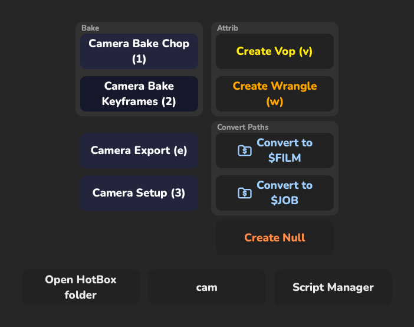
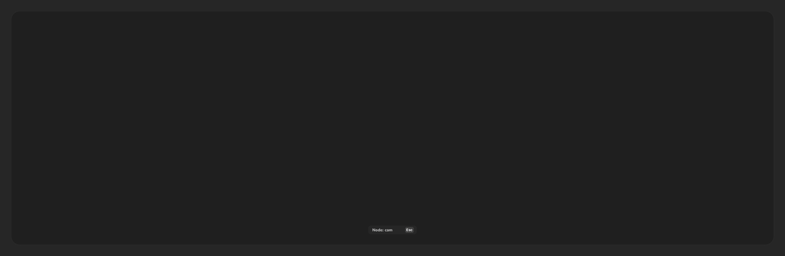
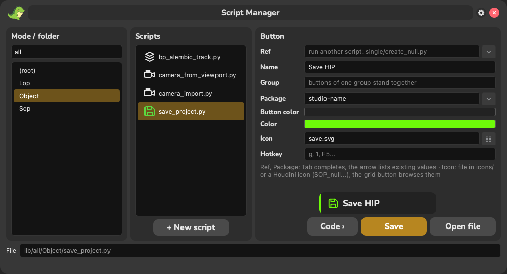
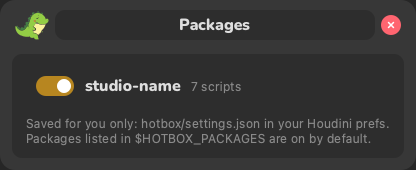

# HotBox

A popup under the mouse with buttons for your own Python scripts in Houdini 21+.
Inspired by [W_hotbox](https://github.com/melMass/W_hotbox) for Nuke (the idea of the hotbox and the Script Manager),
written from scratch for Houdini.
HotBox is an orchestrator: it doesn't do anything by itself, it finds the scripts in `lib/`, shows the ones that fit
what you are doing and runs them.

<p align="center">
  
  
</p>

## What it shows

| Selection | Folder | Columns |
|---|---|---|
| nothing | `lib/all/` | scripts of the current network type (`Sop/`, `Lop/`, `Object/`, `Driver/`…) + root scripts |
| several nodes | `lib/multiple/` | scripts of the network type + root scripts |
| one node | `lib/single/` | scripts of the node type (`cam/`, `null/`…) + root scripts |

Deeper folders (`lib/all/Lop/Instances/`) are not shown.

Buttons go top to bottom in columns (context scripts, then root scripts), at most 6 per column, and
each column goes down at its own pace. Single buttons and `#group` blocks are sorted by group name /
label (not by file names). A group is a framed block with a caption; it is never split between columns (a group
with one button is framed too). The stripe of the buttons of a group has the group color (the color of its first
button), icons keep the color of their script.

A button is one line: the script color on the stripe and the icon (line icons from `icons/` take the color, Houdini
icons keep theirs), the label in neutral grey with the hotkey letter underlined, the hotkey in a keycap on the right.
Hover a button for what the script does (the first comment of its code or the docstring of `main()`) and what it works
on. The buttons stand on a dark backdrop, so the network behind doesn't mix with them.

Bottom row, lower and quieter: open the HotBox folder · where the hotbox opened (`Network: Sop`, `Node: cam`,
`Nodes: Sop`; click or `Esc` closes) · Script Manager.
`Esc` or `` ` `` closes the hotbox, so does a click anywhere that is not a button (outside or between buttons). Clicking a button or pressing its hotkey closes the hotbox and runs the script.
Hotkeys work in the Russian keyboard layout too (the same physical key: `f` = `а`).
Everything a script does is one undo step.

**Tab** starts search: type a part of a label (in any keyboard layout), the other buttons fade out, `Enter` runs the
first match, `Esc` or `Tab` ends the search.

Animations: on opening the buttons grow in from their centers with a small spring, starting at the cursor and
spreading outwards (farther buttons come a bit later). On hover a white wave spreads from the cursor, the button gets lighter and a bit bigger (with the text).
Closing plays it in reverse: the buttons swell a little and shrink to their centers, the farthest from the cursor
first. On click or hotkey the pressed button grows and fades out while the others shrink away, then the script runs.

## Adding a script

Drop a `.py` file into the right folder. Its button is described by the first comment lines:

```python
#label:Create Null
#textcolor:#ff8b48
#buttoncolor:#22253b
#icon:app_dino_dance.svg
#hotkey:n
#group:Nodes

import hou
...
```

Write scripts for any number of selected nodes (`for node in hou.selectedNodes()`): then one script serves
`lib/single/` and `lib/multiple/`.

### The same tool in another mode: `#ref`

A file with only a header runs another script from `lib/`:

```python
#ref:single/create_null.py
#hotkey:n
```

It takes the label, colors, icon and group of the target (its own header overrides them); the hotkey is not
inherited, choose it per context. A broken reference (file renamed, loop) shows a red button with the reason
in the tooltip; the tests check every `#ref` in `lib/`.



Or edit them in the **Script Manager** (bottom right button, the DinoWrite look, with a live animated preview of
the button; like the buttons, its windows grow in from the center with a spring and shrink away on close): it writes the header back into the script and warns
about hotkeys already used by scripts shown together with it and about missing icons. For a `#ref` it edits only
the reference's own header (inherited values are shown greyed out); the **Ref** field sets or changes the target.
Ref and Package complete existing values inline (Tab accepts), the arrow next to them lists them.
The fields go Name → Group → Hotkey → Icon → Accent (stripe and line icon, `#textcolor`) → Background
(`#buttoncolor`); Ref and Package are folded under **Advanced** (open by themselves for a script that uses them).
**Hotkey**: click the field and press the key (shown as its keycap, `K`; Backspace clears); a key taken by a script
shown together with this one is named right away (`K is taken: Background`). The script list shows button names with
the file in grey under them and the hotkey on the right; the search field above it finds scripts of every folder of the
mode by name or file. Right click a script: Duplicate (`name_copy.py`, without the hotkey), Open file, Delete (the
question names the scripts that `#ref` it). Unsaved changes put a dot in the title and turn Save on; switching to
another script or closing asks whether to save them. The footer shows `hotbox/lib/...`, the full path in its tooltip.
**+ New script** (Ctrl+N) creates the file right there: name (the file name follows it), mode, folder (existing
folders, the selected node type or network types are offered) and, with `HOTBOX_PATH`, which lib folder to save in;
the new script opens in the code panel with a starting body for its mode.
**Code ›** slides out a code editor (Python highlighting): the script's code, or the target's code for a `#ref`;
Save writes the header and the code.

All keys are optional (the label defaults to the file name). `#icon` is a file in `icons/` (`save.svg`) or a
Houdini icon name, the one `node.type().icon()` returns (`SOP_attribwrangle`, `SOP_null`, `OBJ_camera`, `LOP_fetch`...).
The grid button next to the Icon field browses them: Houdini's own icons by category (SOP, OBJ, LOP...) and the
HotBox ones, with search; double click or Choose puts the name into the field.
**+ Add icons…** copies your `.svg` / `.png` / `.jpg` files into `icons/` of your first `HOTBOX_PATH` folder (without
`HOTBOX_PATH`: into `hotbox/icons/`); they show up under HotBox and `#icon:my_tool.svg` finds them.
The script runs as `__main__`, `sys.exit()` just stops it. When it fails, a window shows the error and the traceback;
**Open in Script Manager** opens the script with the failing line highlighted in the code panel.

### Your own scripts: `HOTBOX_PATH`

Keep personal and studio scripts outside the tool folder, so `git pull` never touches them:

```
HOTBOX_PATH = "$HOME/houdini_scripts/hotbox_lib;//server/pipeline/hotbox_lib"
```

Each folder has the same layout as `lib/` (`all/`, `multiple/`, `single/`), plus `icons/` for your icon files. Folders are searched in order, the
built-in `lib/` last: a script hides the one with the same path in later folders (your `single/create_null.py`
replaces the built-in one), and `#ref` targets are looked up the same way. The Script Manager marks scripts from
these folders with the folder name; "HotBox Folder" opens the first one. Separator: `;` (`:` works too on
Linux/macOS).

The package switches are saved per user in `$HOUDINI_USER_PREF_DIR/hotbox/settings.json`.

### Packages: studio specific scripts

Scripts that only make sense at one studio go into a package:

```python
#label:Camera Import
#package:studio-name
```

The gear in the Script Manager title bar lists all packages with a switch each. A turned off package hides its
buttons (and its `#ref`s) from the hotbox; scripts without `#package` are always shown. Several packages:
`#package:studio-name, other-studio` (shown when any of them is on).



New packages are **off** by default, so a copied HotBox doesn't show someone else's studio buttons. The choice is
saved per user in `$HOUDINI_USER_PREF_DIR/hotbox/settings.json` (not in the tool folder). A studio can turn
packages on for everyone in `houdini.env`; the user's own switch still wins:

```
HOTBOX_PACKAGES = "studio-name"
```

The studio specific scripts in `lib/` (Camera Import/Export/Setup, Last Alembic Track, Convert to $FILM, Save HIP)
are in packages: turn them on in the gear menu if you need them.

### Shipped scripts

| Where | Scripts |
|---|---|
| everywhere, nothing selected | Flipbook, **Scene**: Missing Files (pick to jump to the nodes), Reload Caches |
| Object, nothing selected | Camera from View (new camera at the viewport view, looks through it) |
| Sop, nothing selected | Object Merge Relative / Absolute (from node paths in the clipboard) |
| Lop, nothing selected | Fetch Relative / Absolute, SOP Import (prims at `/$OS`, the import node name, followed by Render Geometry Settings: Karma geometry + instance velocity blur, Set or Create), **Materials**: Material Library + Assign, Jump to Material (of the prim picked in the viewer: selects the material node that makes it), Material Report (materials of the shown stage with prim counts, prims without a material get picked), **Solaris**: Prim Paths (opens [DionysUSD](https://github.com/matzubr/DionysUSD) on the network, when it is installed), Set Variant (variants of the picked prim and its parents → Set Variant LOP), USD Dependencies (layers, references, payloads, textures the stage reads; missing first, UDIMs too), Show as USDA (the displayed node's layer or the flattened stage in your editor), Picked Prims to… (picked prims → Prune / Configure Primitive / Edit Properties / Edit / Collection) |
| any node(s) selected | **Create**: Vop / Wrangle / Null, Convert Paths, **Copy**: Node Path / File Path, **Network**: Network Box (name, padding in screen pixels, default 15 and remembered; grey after black of the Houdini palette, Color... picks another), Color by Type |
| several nodes | Explode Nodes, Object Merge Paste, Frame Range (all of them together) |
| wrangles (attrib SOP / LOP, volume, pop, geometry, gas field), OpenCL (SOP, Gas OpenCL, Copernicus), Python SOP, Python Script LOP | **Code**: Snippets (opens [mnemo](https://github.com/matzubr/mnemo): search the snippets, Enter inserts into the node, when it is installed) |
| null | Render Node (`RENDER_` geo object under the current one, never on top of other nodes) |
| null, several SOPs | **Solaris**: To Solaris (SOP Import in `/obj/lopnet1`, created when missing, prims at `/$OS` = `/IMPORT_<name>`, + Render Geometry Settings with geometry + instance velocity blur, its prim pattern tied to the import's path prefix) |
| filecache, file, rop_geometry with a `.vdb` | **Solaris**: Volume to Solaris (Volume LOP in `/obj/lopnet1`, prim `/vol/<name>`, the sequence as `$F4` with `$HIP`/`$JOB` kept, sampled over the frames on disk or the node's range) |
| cam / hlight | Look Through (again: back to perspective), Camera Bake, Frame Range |
| alembic, alembicarchive, filecache, file | Frame Range: scene and playback range from the Alembic animation or the sequence on disk |
| any node(s) selected | **Network**: Snap to Grid (onto the Network Editor grid, never on top of another node) |
| cache nodes (filecache, rop_geometry...) | Cache Network: a TOP (ROP Fetch + Wait for All) or ROP (Fetch) network writing them upstream first; more cache types in `CACHE_TYPES` of `lib/multiple/cache_network.py` |

Tools seen in other Houdini libraries come as packages named after the library (all off by default,
[AwesomeHoudini](https://github.com/wyhinton/AwesomeHoudini) lists them). The code here is HotBox's own:

| Package | Scripts |
|---|---|
| `qLib` | Recover Crash, Jump to Path, **Viewport**: Templates / Guides / Background / Time-Dep. Badges, **Select**: Bypassed / Animated (time-dependent) / Modified / Same Type, Sticky Note (no background, white large text), Reference Copy, Compile Block (Sop), Bypass, Open Folder (file nodes, ROPs), Open in MPlay (file), Dolly Zoom (cam) |
| `Aelib` | Save Incremental, Open HIP Folder, Lock Camera (cam, hlight) |
| `LV-Tools` | Space Below (one node), Wedge (Wedge -> ROP Geometry Output for picked parameters), Load Wedges (ropgeometry TOP: File SOP per written wedge + Switch), Transfer Transform (two objects), Cache Size (filecache) |
| `BeeHou` | Focus Target (cam: a null that drives the focus distance) |
| `AutoCacheOut` | Version Up (filecache) |
| `HelpToComment` | Help → Comment (the help summary as the node comment) |

### Shared helpers: `common/`

Small pieces several scripts need, split by topic (whole tools stay scripts in `lib/`):

| Module | |
|---|---|
| `common/panes.py` | Network Editor / Scene Viewer under the cursor, status bar warnings |
| `common/nodes.py` | node paths from the clipboard, Object Merge / Fetch / SOP Import at the cursor, attrib VOP/wrangle under the selection, a free spot for a new node |
| `common/paths.py` | file parameters of a node and of the scene, `$JOB`/`$FILM` path conversion, missing files, reload of file nodes |
| `common/frames.py` | frame range of a node: Alembic animation, file sequence on disk, keyframes |
| `common/layout.py` | Network Editor grid step, snapping to it without overlaps, making space |
| `common/hipfile.py` | incremental hip names, crash files and backups, opening a folder in Finder / Explorer |
| `common/solaris.py` | SOP Import / Volume LOP in `/obj/lopnet1`, Render Geometry Settings with velocity blur |
| `common/caches.py` | the ROP of a cache node, TOP / ROP networks writing caches in dependency order |
| `common/wedge.py`, `common/mplay.py` | Wedge TOP for parameters, image sequences in MPlay |

```python
from hotbox.common import paths

paths.convertPaths("$JOB")
```

Headers are read from the files every time the hotbox opens: nothing is cached, nothing is written into the tool folder.
The folder can be copied from user to user as is.

> Older versions kept a `lib/<mode>/schema.json` cache with absolute paths of the machine it was created on, and it
> had to be deleted after copying the tool to another user. It isn't used any more: delete leftover `schema.json`
> files, they are ignored by git.

## Install

**As a Houdini package** (recommended): clone the repo anywhere, then copy `hotbox.json` into
`$HOUDINI_USER_PREF_DIR/packages/` (e.g. `~/houdini21.0/packages/`, create the folder if needed) and set the path:

```json
{"HOTBOX_DIR": "D:/tools/hotbox"}
```

After a Houdini restart there is a **HotBox** shelf with two tools: *HotBox* (give it a hotkey in the Hotkey
Manager, search "HotBox") and *HotBox Scripts* (the Script Manager). Updating is `git pull`; the tool folder has no
personal files.

**By hand**: put the `hotbox` folder into `python3.11libs` of your Houdini preferences
(e.g. `~/houdini21.0/python3.11libs/hotbox`) and make a hotkey or shelf tool:

```python
import hotbox
hotbox.show()
```

Updated code is reloaded automatically on the next `show()` (no Houdini restart). The old
`from hotbox import main; main.start()` still works.

Camera Import / Camera Export use the studio `cam_tools` library: set its folder in `houdini.env`:

```
CAM_TOOLS_PATH = "//<server>/tools/py_libs/camera_exchanger"
```

The Flipbook button runs [DinoWrite](https://github.com/matzubr/DinoWrite), installed next to `hotbox`.

## Development

Houdini imports the folder directly; [uv](https://docs.astral.sh/uv/) is only for dev tooling (Python 3.11 like Houdini 21,
PySide6 for offscreen GUI tests, `hou` is stubbed). The repo folder must be named `hotbox`.

```bash
uv sync
uv run pytest
uv run ruff check __init__.py main.py common utils tests
uv run python docs/make_images.py   # README images (needs ffmpeg)
```

## Credits

Buttons use [Nunito](https://github.com/googlefonts/nunito) ExtraBold (`fonts/`, a static cut of the variable font),
SIL Open Font License 1.1, see `fonts/OFL.txt`.
